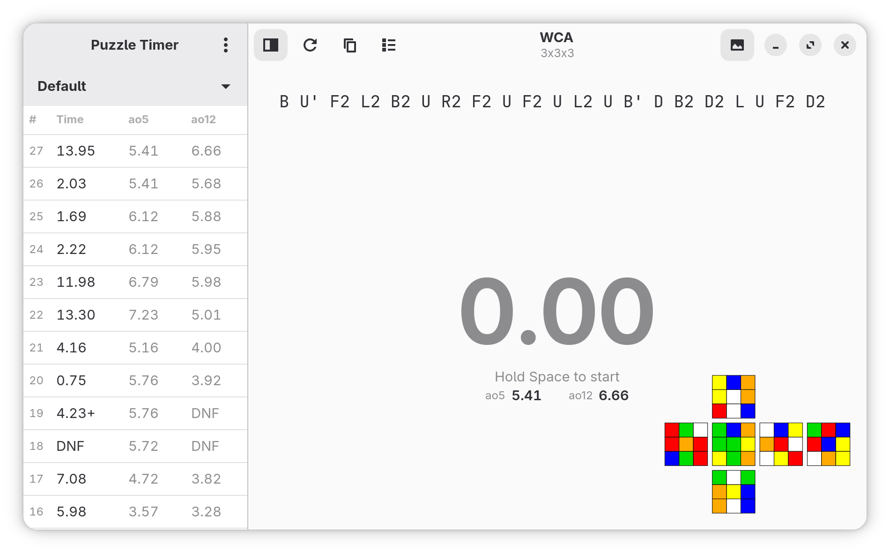

# Puzzle Timer


A speed cubing timer, mainly targeting Linux and designed for GNOME desktop and mobile platforms, with GTK4 and libadwaita.
It is based on [csTimer](https://www.cstimer.net/)'s capability to generate scrambles for 200+ puzzle
types. The UI is also inspired by csTimer, but designed to blend in with GNOME's design language.

This app is currently in early development, and the code is written with the help of AI agents.

Since 0.4.0 it is in Rust; the TypeScript version it replaced is on the `legacy` branch.
A Vala version is planned later as a comparison.



## AI disclosure

Probably important to dress this issue at the beginning. After reading this, you may choose whether to use the app or not, at your own discretion.

The app started as a quick personal project to build a GNOME app with the help of csTimer's nodejs module. I don't want to start with learning GTK4 and libadwaita, or languages like nodejs, Rust, vala. So, I used AI coding agents to help me write the code.

The agents are given a set of design ideas and rules on startup. As the project progresses, I test the app and provide feedback to the agents. Most of the times, the feedback and suggestions are very specific, since I want the app to be developed exactly as I want. For example, sometimes the AI will tend to manually construct a widget, while there is already a well-designed libadwaita widget available. I will do some research and tell AI to use this or that widget instead. That's mainly due to the AI agents' limitations in understanding the UI design: what is good design, what is GNOME's design language, or even, how to properly use GTK4 and libadwaita.

So, in short, the app is not all written by AI automatically with just a few prompts. It's an app designed by me, who relies on AI's help to implement the design. Not only that, I am constantly learning and doing research, hoping to do more coding or optimization myself.

Here is what is done by me, at the current stage:
- The design of the app, including features and UI layout.
- Instructing the AI agents to write the code, in OpenCode.
- Researching and testing the app, and providing feedback to the AI agents.
- Some documents, currently [README.md](./README.md) and [CHANGELOG.md](./CHANGELOG.md).
- The app icon. That is completely hand-drawn, with Inkscape and love.

## Features

- **Adaptive layout**: Designed to fit portrait and landscape windows of desktop and mobile devices.
- **Timer**: Start and stop with keyboard, mouse or touch screen.
- **Inspection**: WCA compliant 15-second inspection.
- **Scrambles**: 200+ puzzle types supported by [csTimer](https://cstimer.net) (Thanks!),
  including WCA puzzles:
  - 2x2
  - 3x3
  - 4x4
  - 5x5
  - 6x6
  - 7x7
  - 3x3 Blindfolded
  - 3x3 Multi-Blindfolded
  - 4x4 Blindfolded
  - 5x5 Blindfolded
  - 3x3 Fewest Moves
  - 3x3 One-Handed
  - Megaminx
  - Pyraminx
  - Skewb
  - FTO
  - Square-1
- **Sessions**: create/rename/switch/delete, per-session scramble type.
- **Statistics**: averages, personal-bests, activities, etc.
- **Records**: `+2`/`DNF`, comments, scramble.
- **Migration**: import from and export to data files, mostly compatible with csTimer.

## Install

There are no packages yet, so the app is built from source. You need a Rust toolchain, `pkg-config`, and the development packages for GTK 4.24, libadwaita 1.9 and JavaScriptCore 6:

- **Arch:** `sudo pacman -S rust gtk4 libadwaita webkitgtk-6.0 pkgconf`
- **Fedora:** `sudo dnf install rust cargo gtk4-devel libadwaita-devel javascriptcoregtk6.0-devel pkgconf-pkg-config`
- **Debian/Ubuntu:** `sudo apt install rustc cargo libgtk-4-dev libadwaita-1-dev libjavascriptcoregtk-6.0-dev pkg-config`

Then clone or download this repo, and build it:

```sh
cargo build --release
./target/release/puzzle-timer
```

[BUILD.md](./BUILD.md) covers tests, the scramble sweep and the UI harness.

## Credits

- csTimer's scramble generation module, [cstimer_module](https://www.npmjs.com/package/cstimer_module).
- Icon inspiration from Reversi. "[Great Artists Steal](https://blogs.gnome.org/tbernard/2019/12/30/designing-an-icon-for-your-app/)". I am not an artist at all, but I did it nevertheless. Thanks!

## License

GPL-3.0-or-later, see [LICENSE](./LICENSE) for details.
