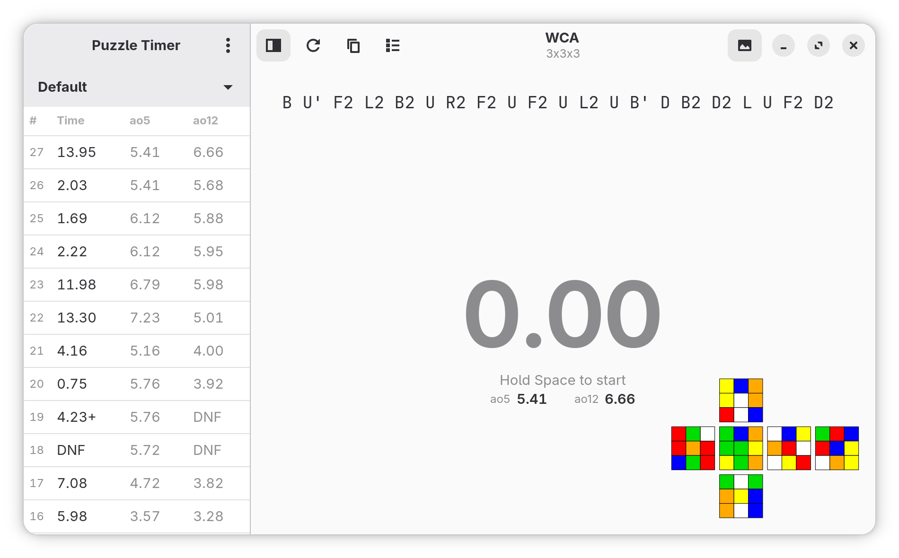

# Puzzle Timer

A speed cubing timer for GNOME desktop, with GTK4 and libadwaita.
It is based on [csTimer](https://www.cstimer.net/)'s capability to generate scrambles for 200+ puzzle
types. The UI is also inspired by csTimer, but designed to blend in with GNOME's design language.

This app is currently in early development. The code is in TypeScript and is written with the help of AI agents. Future plans include porting the code to Rust or vala, and manually maintaining the codebase as much as possible. The design is mostly settled, though.



## AI disclosure

Probably important to dress this issue at the beginning. After reading this, you may choose whether to use the app or not, at your own discretion.

The app started as a quick personal project to build a GNOME app with the help of csTimer's nodejs module. I don't want to start with learning GTK4 and libadwaita, or languages like nodejs, Rust, vala. So, I used AI coding agents to help me write the code.

The agents are given a set of design ideas and rules on startup. As the project progresses, I test the app and provide feedback to the agents. Most of the times, the feedback and suggestions are very specific, since I want the app to be developed exactly as I want. For example, sometimes the AI will tend to manually construct a widget, while there is already a well-designed libadwaita widget available. I will do some research and tell AI to use this or that widget instead. That's mainly due to the AI agents' limitations in understanding the UI design: what is good design, what is GNOME's design language, or even, how to properly use GTK4 and libadwaita.

So, here is what is done by me, at the current stage:
- The design of the app, including features and UI layout.
- Instructing the AI agents to write the code, in OpenCode.
- Researching and testing the app, and providing feedback to the AI agents.
- Some documents, currently [README.md](./README.md) and [CHANGELOG.md](./CHANGELOG.md).
- The app icon. That is completely hand-drawn, with Inkscape and love.

## Features

- **Timer** — Currently support start and stop timer with keyboard.
- **Inspection** — WCA compliant 15-second inspection.
- **Scrambles** — 200+ puzzle types supported by [csTimer](https://cstimer.net) (Thanks!),
  including WCA puzzles:
  - 2x2
  - 3x3
  - 4x4
  - 5x5
  - 6x6
  - 7x7
  - 3x3 Blindfolded
  - 3x3 Multi-Blindfolded
  - 4x4 Blindfolded
  - 5x5 Blindfolded
  - 3x3 Fewest Moves
  - 3x3 One-Handed
  - Clock (RIP)
  - Megaminx
  - Pyraminx
  - Skewb
  - FTO(Face-turning Octahedron)
  - Square-1
- **Sessions** — create/rename/switch/delete, per-session scramble type.
- **Statistics** — ao5/ao12/mo3, targets, etc.
- **Solve records** — `+2`/`DNF`, comments, scramble. Editable.

## Install

You need `nodejs`, and install `node-gtk`'s dependencies as instructed [here](https://github.com/romgrk/node-gtk/).

Then clone or download this repo, and install needed nodejs packages:
```sh
npm install
```
And, start the app:
```sh
npm start
```

## Credits

- csTimer's scramble generation module, [cstimer_module](https://www.npmjs.com/package/cstimer_module).
- Icon inspiration from Reversi. "[Great Artists Steal](https://blogs.gnome.org/tbernard/2019/12/30/designing-an-icon-for-your-app/)". I am not an artist at all, but I did it nevertheless. Thanks!

## License

GPL-3.0-or-later, see [LICENSE](./LICENSE) for details.
